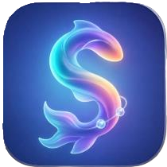

<div align="center">



# ✦ SoftSync

### Học kỹ năng mềm cùng AI — phát triển hôm nay, dẫn lối ngày mai.

Nền tảng học tập kỹ năng mềm cá nhân hóa, kết hợp đánh giá năng lực, lộ trình học,
trợ lý AI, thực hành tình huống và bộ công cụ nghề nghiệp trong một trải nghiệm thống nhất.

[](https://softsync.id.vn/)
[](https://dotnet.microsoft.com/)
[](https://www.postgresql.org/)
[](https://www.docker.com/)

[](https://github.com/JayC0603/SoftSync/actions/workflows/keep-softsync-awake.yml)
[](#-license)

**[Trải nghiệm SoftSync](https://softsync.id.vn/)** ·
**[Báo lỗi](https://github.com/JayC0603/SoftSync/issues)** ·
**[Tài liệu AI](API_INTEGRATION_NOTES.md)**

</div>

---

## 🌌 Giới thiệu

SoftSync giúp người học nhận diện điểm mạnh, cải thiện kỹ năng mềm và theo dõi sự
tiến bộ qua từng hoạt động. Giao diện sử dụng phong cách **dark space + liquid
glass**, tối ưu cho cả desktop lẫn thiết bị di động.

> [!IMPORTANT]
> Ứng dụng production hiện tại là `SoftSync.Presentation` sử dụng ASP.NET Core
> Blazor Server. `SoftSync.Next` là frontend Next.js đang được phát triển/migration
> và chưa thay thế toàn bộ hệ thống Blazor.

## ✨ Tính năng nổi bật

| Mô-đun | Khả năng |
| --- | --- |
| 🧠 **Đánh giá kỹ năng** | Bài đánh giá, phân tích năng lực và đề xuất hướng cải thiện |
| 🗺️ **Lộ trình cá nhân hóa** | Lộ trình theo mục tiêu, bài học, quiz và lưu vị trí học |
| 🤖 **Trợ lý AI** | Hỏi đáp dựa trên kho kiến thức SoftSync và tài liệu PDF |
| 🎭 **Roleplay** | Thực hành giao tiếp qua tình huống và nhận phản hồi AI |
| 📈 **Theo dõi tiến độ** | Điểm, level, streak, lịch sử bài làm và biểu đồ tiến bộ |
| 🎮 **Mini game** | Game giao tiếp, tư duy phản biện và quản lý thời gian |
| 👥 **Mentor & Community** | Kết nối mentor, case study và cộng đồng học tập |
| 📄 **CV Intelligence** | Lưu trữ, matching CV–JD, ranking, comparison và tìm kiếm CV |
| 🔐 **Identity** | Đăng ký, đăng nhập, OTP, phân quyền và Google OAuth 2.0 |
| 🌐 **Song ngữ** | Tiếng Việt/English, light/dark mode và accessibility |

## 🖼️ Trải nghiệm giao diện

- Dashboard kiểu space studio với sidebar desktop và bottom navigation trên mobile.
- Liquid glass, aurora background và hiệu ứng tương tác theo con trỏ.
- Responsive cho điện thoại, tablet và desktop.
- Hỗ trợ `prefers-reduced-motion`, keyboard focus và high-contrast mode.

## 🧱 Kiến trúc hệ thống

```text
┌─────────────────────────────────────────────────────────────┐
│                    SoftSync.Presentation                    │
│       Blazor Server · Identity · Vite · Tailwind · UI      │
└──────────────────────────────┬──────────────────────────────┘
                               │
┌──────────────────────────────▼──────────────────────────────┐
│                         SoftSync.BLL                        │
│          Business services · Authorization · AI layer      │
└──────────────────────────────┬──────────────────────────────┘
                               │
┌──────────────────────────────▼──────────────────────────────┐
│                         SoftSync.DAL                        │
│         EF Core · Repositories · Migrations · Identity     │
└──────────────────────────────┬──────────────────────────────┘
                               │
┌──────────────────────────────▼──────────────────────────────┐
│                         PostgreSQL                          │
└─────────────────────────────────────────────────────────────┘

SoftSync.Common ── DTOs · Enums · Scoring · Shared rules
SoftSync.Next   ── Next.js migration + CV dashboard/proxy
SoftSync.Tests  ── Unit tests cho các workflow cốt lõi
```

| Project | Vai trò |
| --- | --- |
| `SoftSync.Presentation` | Web app production, Blazor Server và authentication |
| `SoftSync.BLL` | Business logic, authorization và AI services |
| `SoftSync.DAL` | EF Core, PostgreSQL, repositories và migrations |
| `SoftSync.Common` | DTO, enum, scoring và quy tắc dùng chung |
| `SoftSync.Tests` | Unit tests |
| `SoftSync.Next` | Next.js frontend và CV dashboard đang phát triển |

## 🛠️ Công nghệ

| Nhóm | Công nghệ |
| --- | --- |
| Backend | ASP.NET Core 10, Blazor Server, C# |
| Authentication | ASP.NET Core Identity, Cookie Auth, Google OAuth 2.0 |
| Database | PostgreSQL 16, Entity Framework Core, Npgsql |
| Frontend | Razor Components, Bootstrap, Tailwind CSS 4, Vite 6 |
| AI | Hugging Face-compatible APIs, knowledge base, PDF extraction |
| CV workspace | Next.js 15, React 19, TypeScript |
| Infrastructure | Docker, Docker Compose, GitHub Actions |
| Testing | xUnit / .NET Test SDK |

## 🚀 Chạy nhanh với Docker

### Yêu cầu

- Docker Desktop hoặc Docker Engine + Compose.
- Git.

### Khởi động

```bash
git clone https://github.com/JayC0603/SoftSync.git
cd SoftSync/SoftSync-main
cp .env.example .env
docker compose up --build
```

| Dịch vụ | URL |
| --- | --- |
| SoftSync | <http://localhost:8081> |
| pgAdmin | <http://localhost:5050> |
| PostgreSQL | `localhost:5432` |

Tài khoản pgAdmin mặc định dành cho local development:

```text
Email:    admin@softsync.com
Password: admin
```

> [!WARNING]
> Không sử dụng mật khẩu development mặc định trên production.

## 💻 Chạy trực tiếp bằng .NET

### Yêu cầu môi trường

- .NET SDK 10.0.
- Node.js 20+ và npm.
- PostgreSQL 16+.

### Cài đặt

```bash
git clone https://github.com/JayC0603/SoftSync.git
cd SoftSync/SoftSync-main

dotnet restore SoftSync.sln
npm install --prefix SoftSync.Presentation
dotnet ef database update --project SoftSync.DAL --startup-project SoftSync.Presentation
dotnet run --project SoftSync.Presentation
```

Ứng dụng local:

- <https://localhost:7212>
- <http://localhost:5104>

Trong lúc phát triển UI, chạy hai terminal:

```bash
# Terminal 1 — build/watch Tailwind + Vite
npm run dev --prefix SoftSync.Presentation

# Terminal 2 — Blazor hot reload
dotnet watch --project SoftSync.Presentation
```

## ⚙️ Biến môi trường

Sao chép `.env.example` thành `.env` khi chạy Docker. Production nên dùng secret
manager của nền tảng hosting.

| Biến | Bắt buộc | Mô tả |
| --- | :---: | --- |
| `DATABASE_URL` | ✅ Production | PostgreSQL URI do hosting cung cấp |
| `ConnectionStrings__SoftSyncDb` | ✅ Local/khác | Connection string PostgreSQL chuẩn Npgsql |
| `Authentication__Google__ClientId` | Google OAuth | OAuth Web Client ID |
| `Authentication__Google__ClientSecret` | Google OAuth | OAuth Client Secret — không commit |
| `BootstrapAdmin__Email` | Không | Email admin khởi tạo |
| `BootstrapAdmin__Password` | Không | Mật khẩu admin khởi tạo |
| `AiApi__ApiKey` | AI thật | API key của AI provider |
| `RecruitmentAi__BaseUrl` | CV AI | URL của dịch vụ FastAPI CV/JD |
| `FRONTEND_ORIGINS` | Tách frontend | Danh sách CORS origins, phân tách bằng dấu phẩy |

## 🔐 Google OAuth 2.0

Nút **Tiếp tục với Google** luôn xuất hiện trên trang đăng nhập và đăng ký.
Khi thiếu cấu hình, nút bị vô hiệu hóa và hiển thị thông báo thay vì biến mất.
Đăng nhập Google khi chưa có tài khoản sẽ hiển thị hướng dẫn và nút đăng ký.
Tài khoản Google mới chỉ được tạo từ luồng đăng ký, không cần mật khẩu và chuyển đến thiết lập hồ sơ;
tài khoản đã liên kết chuyển đến dashboard hoặc trang nội bộ được yêu cầu.
Nếu email trùng tài khoản dùng mật khẩu, người dùng phải xác nhận mật khẩu trước
khi liên kết Google. Email chưa được Google xác minh không được dùng để tạo tài khoản.
Luồng này không bỏ qua khóa tài khoản hoặc xác thực hai bước.

Tạo OAuth Client loại **Web application** trong Google Cloud Console.

| Môi trường | Authorized redirect URI |
| --- | --- |
| Local .NET | `https://localhost:7212/signin-google` |
| Docker Compose | `http://localhost:8081/signin-google` |
| Production | `https://softsync.id.vn/signin-google` |

Production origin:

```text
https://softsync.id.vn
```

Local bằng User Secrets:

```powershell
dotnet user-secrets set "Authentication:Google:ClientId" "YOUR_CLIENT_ID" --project SoftSync.Presentation
dotnet user-secrets set "Authentication:Google:ClientSecret" "YOUR_CLIENT_SECRET" --project SoftSync.Presentation
```

> [!CAUTION]
> Không ghi Client Secret vào `appsettings.json`, Dockerfile, source code hoặc
> commit Git. Nếu secret từng bị công khai, hãy rotate ngay trong Google Cloud.

## 🤖 Tích hợp AI

Các AI service tuân theo interface ở `SoftSync.BLL`, giúp thay đổi provider mà
không ảnh hưởng UI. Xem [API_INTEGRATION_NOTES.md](API_INTEGRATION_NOTES.md) để
cấu hình assessment, assistant, roadmap, quiz và roleplay AI.

Kho kiến thức mặc định:

```text
SoftSync.Presentation/Assets/AiKnowledge/
```

## 📄 CV Dashboard / Next.js

`SoftSync.Next` chứa workspace CV tại route `/cv`:

- CV Storage.
- CV–JD Matching.
- CV Ranking.
- CV Comparison.
- Hybrid/Web CV Search.
- API proxy `/api/cv/*` để giữ URL backend ở phía server.

```bash
cd SoftSync.Next
cp .env.example .env.local
npm install
npm run dev
```

```text
CV_API_URL=https://your-cv-api-service.example.com
NEXT_PUBLIC_GOOGLE_CLIENT_ID=your-google-oauth-client-id
```

## 🎨 Quy ước giao diện

Dự án kết hợp Bootstrap và Tailwind CSS. Tailwind dùng prefix `tw:` để tránh
xung đột utility class:

```razor
<!-- Tailwind: luôn có prefix tw: -->
<div class="tw:grid tw:grid-cols-1 tw:md:grid-cols-3 tw:gap-6">

<!-- Bootstrap: không dùng prefix -->
<button class="btn btn-primary">Tiếp tục</button>
<i class="bi bi-check-circle-fill"></i>
```

| Class | Công dụng |
| --- | --- |
| `.ss-glass` | Bề mặt kính mờ |
| `.ss-glass-interactive` | Ánh sáng tương tác theo con trỏ |
| `.ss-card` | Card dùng chung |
| `.ss-aurora` | Nền aurora động |

## 🧪 Build và kiểm thử

```bash
# Build toàn solution
dotnet build SoftSync.sln

# Chạy unit tests
dotnet test SoftSync.Tests/SoftSync.Tests.csproj

# Build Next.js production
npm run build --prefix SoftSync.Next
```

Trạng thái kiểm tra gần nhất: **54 tests passed** ✅

## 🐳 Triển khai production

Ứng dụng production được đóng gói bằng:

```text
SoftSync.Presentation/Dockerfile
```

Container production cần các biến cơ bản:

```text
ASPNETCORE_ENVIRONMENT=Production
DATABASE_URL=postgresql://...
Authentication__Google__ClientId=...
Authentication__Google__ClientSecret=...
```

Health check:

```text
GET /health → {"status":"ok"}
```

GitHub Actions workflow `.github/workflows/keep-softsync-awake.yml` gọi health
endpoint mỗi 10 phút và hỗ trợ chạy thủ công bằng `workflow_dispatch`.

## 🧯 Troubleshooting

<details>
<summary><strong>Không thấy nút “Đăng nhập bằng Google”</strong></summary>

Kiểm tra cả `Authentication__Google__ClientId` và
`Authentication__Google__ClientSecret` đã tồn tại trong môi trường chạy, sau đó
redeploy. Provider chỉ được đăng ký khi có đủ hai giá trị. Khi thiếu cấu hình,
nút Google vẫn hiển thị nhưng bị vô hiệu hóa kèm thông báo.

</details>

<details>
<summary><strong>Google báo redirect_uri_mismatch</strong></summary>

Callback trong Google Cloud phải khớp tuyệt đối protocol, hostname, port và path.
Production sử dụng `https://softsync.id.vn/signin-google`.

</details>

<details>
<summary><strong>Không kết nối được PostgreSQL</strong></summary>

Kiểm tra `DATABASE_URL` hoặc `ConnectionStrings__SoftSyncDb`, trạng thái database,
SSL và network access. Container runtime bao gồm thư viện GSSAPI cần cho Npgsql.

</details>

<details>
<summary><strong>CSS mới chưa xuất hiện</strong></summary>

Chạy `npm install` và `npm run build` trong `SoftSync.Presentation`, sau đó build
lại .NET/Docker image. Bundle được xuất vào `wwwroot/dist`.

</details>

## 🤝 Đóng góp

1. Fork repository.
2. Tạo branch: `git checkout -b feature/ten-tinh-nang`.
3. Commit: `git commit -m "Add: mô tả thay đổi"`.
4. Push branch và tạo Pull Request.
5. Đảm bảo build/test thành công trước khi gửi.

## 🔒 Bảo mật

- Không commit `.env`, API key, OAuth secret hoặc database password.
- Dùng User Secrets khi phát triển local.
- Dùng secret manager/environment variables trên production.
- Rotate ngay credential nếu nghi ngờ bị lộ.
- Báo cáo vấn đề bảo mật qua kênh riêng thay vì public issue.

## 📂 Cấu trúc thư mục

```text
SoftSync-main/
├── SoftSync.Common/        # Shared DTOs, enums và rules
├── SoftSync.DAL/           # EF Core, entities, repositories, migrations
├── SoftSync.BLL/           # Business logic, auth và AI services
├── SoftSync.Presentation/  # Blazor Server production app
├── SoftSync.Next/          # Next.js + CV workspace
├── SoftSync.Tests/         # Automated tests
├── docker-compose.yml      # Local stack
└── SoftSync.sln            # .NET solution
```

## 📜 License

Repository hiện được phát triển cho dự án SoftSync và chưa công bố giấy phép mã
nguồn mở. Mọi quyền được bảo lưu cho đến khi có tệp `LICENSE` chính thức.

---

<div align="center">

### Built with 💜 by the SoftSync team

**[⬆ Về đầu trang](#-softsync)**

</div>
