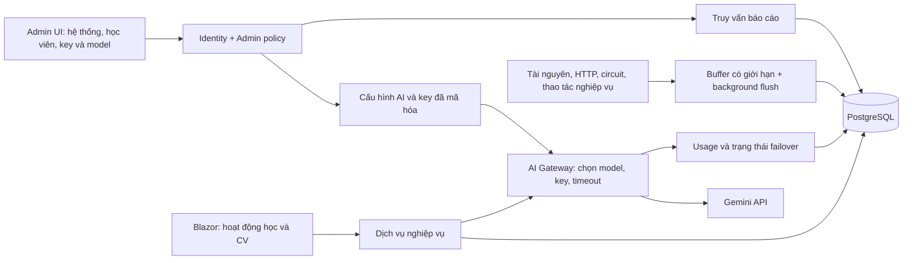

# Kế hoạch Admin Dashboard, thống kê học tập và Gemini

Ngày: 22/10/2026. Trạng thái: bản thiết kế và kế hoạch phân kỳ để chủ dự án duyệt; chưa triển khai chức năng.

## 1. Mục tiêu đã nhận

- Admin xem tài nguyên máy chủ, lưu lượng request, lỗi và tình trạng AI.
- Đo thời gian học có hoạt động, kết quả, mức cải thiện và lưu lịch sử đủ để thống kê sau này.
- SYNCY trả lời câu hỏi qua Gemini; CV được nhận xét, đối chiếu với yêu cầu nhà tuyển dụng, chấm điểm và gợi ý sửa.
- **Chủ dự án tự dán API key và chọn model trên UI Admin.** Hỗ trợ 2–3 key dự phòng, sắp thứ tự; khi cấu hình đang dùng không khả dụng thì chọn key kế tiếp đủ điều kiện.
- Giữ nền tảng Blazor Server .NET 10, Identity, PostgreSQL, song ngữ và light/dark. Giữ bố cục mobile/tablet hiện tại; không thay framework.
- Lượt này chỉ lập kế hoạch. Chưa thay cấu hình AI, database, giao diện hoặc app đang chạy.

Giả định: “flask” trong yêu cầu ban đầu là **Gemini Flash**. Không thêm Python Flask trong phương án đề xuất. Backend FastAPI tuyển dụng được tài liệu nhắc đến là tích hợp riêng, không phải lý do tạo thêm một backend mới.

## 2. Kết quả đọc mã nguồn

| Hiện trạng | Hệ quả cho triển khai |
| --- | --- |
| Có `/admin/users`, `/admin/announcements`, admin policy và quyền teacher | Tái sử dụng phân quyền; thêm dashboard vào khu admin hiện có |
| Login, Dashboard, ProfileSetup và NavBar đang đưa admin tới `/admin/users` | Cập nhật cả bốn điểm để trang mặc định mới là `/admin/dashboard` |
| `ProgressDashboard.razor.cs` dùng `Minutes = [9, 9, 5, 4, 10, 5]` nhân số bước hoàn thành | Đây là thời gian ước tính; không đưa vào báo cáo dưới tên thời gian đo được |
| Có AssessmentResult, QuizAttempt, RoleplaySession và lịch sử JSON trong RoadmapItem | Tái sử dụng điểm/bằng chứng; cần chuẩn hóa sự kiện, nguồn điểm và phiên bản rubric |
| `LlmAiAssistantService` gọi Hugging Face trực tiếp; `HuggingFaceJsonClient` nằm trong `AiLearningEvaluationService.cs` | Chưa có lớp provider Gemini dùng chung; không chỉ đổi BaseUrl hoặc model rồi coi là xong |
| `CvReviewService` đã có chất lượng CV, JD match, feedback song ngữ và kiểm tra phản hồi | Mở rộng luồng này; giữ các kiểm tra chống bịa và rubric hiện có |
| `CvDocumentRecord` và `CvReviewRecord` đã lưu CV/JD/kết quả | Bổ sung cột thống kê và phiên bản, không tạo kho CV thứ hai |
| `/cv` dùng `CvCareerWorkspace`; iframe CV bên ngoài là công cụ mở rộng | Luồng Gemini chính triển khai ở backend .NET và workspace đang dùng |
| `RecruitmentAiClient` có bộ matching riêng | Giữ score/model của hệ đó riêng với điểm chất lượng và điểm JD do Gemini hỗ trợ |
| Preview đang chạy DemoMode với database in-memory | Muốn thống kê qua nhiều lần restart phải chạy PostgreSQL; demo chỉ dành cho minh họa có gắn nhãn |
| Chưa có hệ thu thập tài nguyên/request phục vụ dashboard | Cần collector, lưu trữ và định nghĩa metric trước khi vẽ biểu đồ |

Tài liệu `CLAUDE.md`/`API_INTEGRATION_NOTES.md` còn mô tả một số AI là Fake, trong khi Program hiện đăng ký các service AI mới. Khi triển khai phải dựa vào mã/DI hiện tại và cập nhật lại tài liệu.

## 3. Lựa chọn kiến trúc

| Phương án | Đánh đổi |
| --- | --- |
| **A — mở rộng .NET + PostgreSQL hiện tại (đề xuất)** | Một hệ đăng nhập, tái sử dụng CV và learning; đủ cho MVP, cần giới hạn và aggregate telemetry để không làm DB nặng |
| B — thêm Python Flask cho Gemini | Thêm deployment, auth liên dịch vụ, retry và cấu hình secrets; chỉ chọn khi đội AI có backend độc lập cần giữ |
| C — Prometheus/Grafana và pipeline analytics riêng ngay từ đầu | Phù hợp hạ tầng nhiều instance, đổi lại thêm vận hành; đưa vào giai đoạn mở rộng khi tải yêu cầu |

Chọn A cho lần đầu, tách interface collector/AI để sau này nối monitoring store khác. Không tự triển khai Prometheus/Grafana hoặc dịch vụ cloud trả phí trong gói đầu.

## 4. Admin tự cấu hình Gemini và key dự phòng

### 4.1. Màn hình `/admin/ai/settings`

- Bật/tắt AI; lựa chọn provider. MVP Gemini là provider mới, vẫn giữ cấu hình Hugging Face cũ để rollback.
- Chọn model theo tác vụ: **Trợ lý SYNCY**, **đánh giá CV/JD**, **đánh giá thực hành**. Có nút dùng chung một model.
- Backend lấy danh sách model hỗ trợ sinh nội dung/structured output bằng key đã lưu; UI chỉ nhận tên và capability. Hiển thị model nào chưa dùng được với key dự phòng.
- Danh sách tối đa **3 key đang bật**; key cũ có thể vô hiệu hóa và giữ metadata cho lịch sử.
- Mỗi key: tên gợi nhớ, trường dán key, nhóm project/quota do admin khai báo, thứ tự 1–2–3, bật/tắt, trạng thái, model khả dụng, lần dùng gần nhất, thời điểm thử lại.
- Thao tác: thêm/thay key, lên/xuống thứ tự, kiểm tra kết nối/model, lưu cấu hình, chọn lại key ưu tiên. Kiểm tra dùng gọi nhẹ tới provider; thử sinh phản hồi là hành động riêng có thể tiêu tốn quota.
- Sau khi lưu chỉ trả masked key/fingerprint; không có chức năng xem lại hoặc sao chép key gốc. Trường rỗng khi sửa có nghĩa giữ key cũ, không ghi đè bằng chuỗi mask.
- Lưu thành phiên bản cấu hình. Validate trước khi áp dụng; request đang chạy dùng snapshot cũ, request mới dùng bản mới, không cần restart app.
- Trạng thái tách rõ: Disabled, Untested, Ready, CoolingDown, QuotaExhausted, InvalidCredential, ModelUnavailable, Unavailable. Không gọi key “Ready” chỉ vì đã lưu chuỗi.

Gemini 1.5 Flash đã ngừng phục vụ ngày 24/09/2025. Không hard-code model đó. Model được chọn từ khả năng truy cập thực tế của project; admin quyết định model, ứng dụng không tự đổi model chấm điểm âm thầm.

### 4.2. Quy tắc chuyển key

1. Trong một request, chốt provider/model/config version và một `OperationId`.
2. Bắt đầu ở key hiện hành; nếu chưa có thì dùng key ưu tiên cao nhất đang Ready và hỗ trợ model đó.
3. Khi cần failover, chọn **key kế tiếp theo thứ tự**; bỏ qua key disabled, invalid, đang cooldown hoặc cùng nhóm quota đang bị chặn. Không lặp vòng vô hạn về key đã thử.
4. Key failover thành công trở thành key hiện hành cho tác vụ đó. Hết cooldown thì key cũ được kiểm tra lại, nhưng không giành lại ưu tiên giữa request; admin có nút “Dùng lại key ưu tiên”.
5. Duy trì trạng thái theo key/model và project/quota nếu đã biết. Đồng bộ bằng optimistic concurrency và reservation trong PostgreSQL khi có nhiều instance; không chỉ dùng biến static.
6. Một request tối đa 3 lượt gọi provider tổng cộng, tính cả retry. Timeout tổng mặc định: chat 45 giây, CV 90 giây. Mỗi lượt không vượt phần deadline còn lại. Một lớp retry chịu trách nhiệm; tránh SDK và gateway cùng tự nhân số lần thử.
7. Chỉ trả/lưu một kết quả thành công. Nếu client hủy, không tiếp tục tốn quota ở key khác. Khi đã stream nội dung cho người dùng, không ghép tiếp câu trả lời từ key khác.
8. Hết key khả dụng: trả trạng thái AI unavailable kèm thời gian thử lại nếu biết; không tạo điểm CV giả hoặc cho lỗi AI thành điểm 0.

| Phản hồi provider | Xử lý đề xuất |
| --- | --- |
| 429 giới hạn RPM/TPM | Tôn trọng Retry-After/RetryInfo, backoff có jitter; cooldown đúng scope. Chỉ dùng cấu hình dự phòng còn quota độc lập |
| Hết RPD hoặc quota dài hạn | Đánh dấu QuotaExhausted; dùng thời điểm reset provider cho biết. Nếu không xác định được thì không đoán ngày reset; báo cần kiểm tra |
| 402/hết credit/billing | Tạm ngừng nhóm bị ảnh hưởng tới khi được kiểm tra lại; chuyển dự phòng đủ điều kiện, không retry liên tục |
| Key sai/bị thu hồi | InvalidCredential, không thử lại key đó trong request; dùng key kế tiếp |
| 403 do chính sách/vùng/quyền model | Lỗi cấu hình/capability; không quay key để vượt hạn chế chính sách |
| Model không tồn tại/đã nghỉ | ModelUnavailable; yêu cầu admin chọn model khác, không tự thay model chấm điểm |
| 400 do schema/nội dung request | Dừng và báo lỗi đúng nguyên nhân; không đốt cả ba key cho cùng payload lỗi |
| 5xx/timeout/mạng | Cho phép một retry có backoff trước khi có output, trong tổng budget; nếu lỗi toàn provider thì mở circuit breaker, không gọi dồn mọi key |
| Nội dung bị chặn | Trả trạng thái phù hợp; không failover để cố lấy nội dung bị chặn |

**Giới hạn quan trọng:** Google áp RPM/TPM/RPD theo project, không theo API key. Ba key cùng project không tạo ba lần quota. Nhóm quota trên UI là metadata admin khai báo, không được coi là chứng minh project từ chuỗi key. Muốn dự phòng khi project hết quota cần cấu hình hợp lệ còn hạn mức độc lập; vẫn tôn trọng quota của từng project.

### 4.3. Lưu key và bảo vệ cấu hình

- API key chỉ gửi từ form Admin tới backend qua kết nối bảo mật, không nằm trong JavaScript bundle, localStorage, JSON cấu hình trả cho browser, telemetry hoặc log URL.
- Lưu `EncryptedSecret`, nonce/tag, phiên bản khóa mã hóa; dùng AES-GCM với master key bền vững lấy từ deployment secret/User Secrets, **ngoài database**. Không lưu master key trong cùng bảng, không tạo lại mỗi lần restart. Nếu thiếu master key thì không cho lưu secret.
- Có quy trình backup/rotate master key trước khi dùng production. Key cũ vẫn giải mã được tới khi re-encrypt xong.
- Tất cả endpoint chỉnh cấu hình yêu cầu Admin policy, chống CSRF và audit người sửa/thời gian/phần metadata đổi. Audit không ghi key hoặc prompt/CV thô.
- Cấu hình được tải server-side; admin UI không cho nhập endpoint tùy ý dẫn tới gửi secret sang host không xác định. Gemini adapter dùng host provider được allowlist.
- UI không cam kết “còn X credit của Google” nếu API không cung cấp số đó. Tách usage do SoftSync ghi nhận và trạng thái quota provider trả về.

## 5. Theo dõi phần cứng và request

### 5.1. Metric MVP

| Nhóm | Chỉ số và cách đọc |
| --- | --- |
| Tài nguyên | CPU tiến trình %, RAM working set, GC heap, uptime; CPU/RAM quota container khi lấy được |
| Storage | Dung lượng volume app nhìn thấy, free bytes; tách khỏi dung lượng PostgreSQL. Không có quyền đọc thì N/A |
| HTTP | Requests trong khoảng, requests/phút, in-flight, 2xx/4xx/5xx, hủy/abort, độ trễ p50/p95 |
| Blazor | Circuit đang kết nối, mở/đóng/reconnect và số thao tác nghiệp vụ; không coi một kết nối SignalR là toàn bộ hành động người dùng |
| Nghiệp vụ | Bắt đầu học, nộp quiz, hoàn thành bước, gửi chat, đánh giá CV; phát từ service xử lý, không đếm từ lượt render |
| AI | Operation thành công/lỗi, provider attempts, failover, token input/output theo usage metadata, latency, key ID/model, lỗi quota |
| Database | Kiểm tra kết nối có timeout, thời gian query thuộc báo cáo; không làm query nặng mỗi lần refresh |

- “Phần cứng” ở đây là server/container chạy SoftSync. Không đọc cấu hình máy cá nhân học viên và không giả định biết CPU/GPU phía Google.
- CPU % phải ghi rõ denominator: tiến trình / CPU quota khả dụng. Không có quota hợp lệ thì ghi rõ normalized theo logical CPU; số đo đầu tiên là N/A.
- MVP lấy mẫu tài nguyên mỗi 15 giây, UI cập nhật khoảng 15 giây khi tab đang mở, lưu aggregate theo phút. Mọi mẫu có InstanceId/Environment/StartedAtUtc/CollectedAtUtc.
- Requests có bộ lọc: tổng HTTP và API nghiệp vụ. Định nghĩa loại trừ riêng static files, health, telemetry ingestion và chính polling admin để biểu đồ không tự tăng bởi chính nó; UI ghi rõ tập đang xem.
- Một HTTP retry là một HTTP request khác; một thao tác AI chỉ là một operation nhưng có thể có nhiều provider attempts. Không gộp nhầm các số này.
- Route metric dùng template `/api/.../{id}`, không lưu query/body/user ID làm nhãn. Giới hạn cardinality; exception message không đưa trực tiếp lên chart.
- Histogram latency dùng bucket có giới hạn và cộng count từng bucket khi tổng hợp; p95 là xấp xỉ theo histogram, không lấy trung bình p95 của nhiều phút/instance.
- Buffer telemetry có giới hạn; worker flush theo batch, upsert theo khóa duy nhất; không ghi DB đồng bộ mỗi HTTP request. Khi đầy/lỗi DB, không chặn học tập; tăng dropped-samples counter và hiển thị khoảng trống dữ liệu.
- Mẫu quá cũ phải hiện “Dữ liệu đã cũ” cùng last-updated, không hiện số 0 hoặc màu xanh khỏe giả.
- Không có DB thì chỉ báo trạng thái trực tiếp và lưu đệm giới hạn; dữ liệu chưa flush có thể mất khi crash, phải thể hiện giới hạn đó.

### 5.2. Màn hình admin

- `/admin/dashboard`: tổng quan hệ thống + học viên + AI, 4–6 KPI chính, biểu đồ theo khoảng thời gian, danh sách vấn đề cần xem.
- `/admin/system`: CPU/RAM, requests, latency, lỗi, circuit; chọn instance và khoảng 1h/24h/7 ngày.
- `/admin/learners`: học viên hoạt động, thời gian có hoạt động, kết quả theo kỹ năng, hoàn thành, số mẫu; tìm và lọc theo lớp/khóa nếu dữ liệu đó thực sự có.
- `/admin/learners/{id}`: timeline, thời gian từng hoạt động, first/latest/best attempt, bằng chứng điểm và nhãn nguồn đánh giá.
- `/admin/ai/settings`: key, model, thứ tự và trạng thái cấu hình.
- `/admin/ai/usage`: operation/attempt/token/lỗi/failover theo model và key; không hiển thị raw prompt/CV trong log vận hành.
- `/admin/cv/analytics`: số review, phân bố quality score và JD-fit, vấn đề phổ biến theo khoảng; mặc định báo cáo tổng hợp.

UI dùng shell desktop hiện có, tím SoftSync, theme/VI-EN. Bộ lọc ngày/instance xuất hiện trước số liệu. Mỗi chart có đơn vị, nguồn, thời gian cập nhật, empty/loading/error/stale. CSS riêng scope `.ss-admin`; không sửa global CSS để ép bố cục học viên. Trang admin mới có bố cục co giãn, bảng cuộn trong vùng riêng khi cần.

## 6. Đo thời gian và chất lượng học tập

### 6.1. Đo hoạt động học

- Khi mở hoạt động hợp lệ, backend cấp session ID gắn với user từ Identity và resource mà user có quyền học.
- Client gửi heartbeat 30 giây khi trang visible và có hoạt động gần đây (mốc idle 120 giây); video đang chạy trong trang visible được tính là hoạt động. Không yêu cầu click liên tục khi đang đọc.
- Server tính phần thời gian giữa hai heartbeat được chấp nhận, tối đa 30 giây/lần; heartbeat đầu không tự cộng 30 giây. Dùng đồng hồ server, không tin tổng phút client gửi.
- Mất heartbeat quá 90 giây thì hết session; hidden/idle/pause không tự cộng. Không bù khoảng offline từ timestamp client hoặc phụ thuộc hoàn toàn vào unload.
- Dedupe theo `(SessionId, Sequence)`; retry cùng heartbeat không cộng lại. Giới hạn tần suất, kiểm tra ownership và thời gian server.
- Hợp nhất các khoảng thời gian của cùng user trên nhiều tab/device khi tính tổng để tránh học 1 phút thành 3 phút.
- Theo dõi đọc/video/quiz/roleplay/reflection riêng; không cộng thời gian chat hoặc trang CV thành thời gian học trừ khi định nghĩa báo cáo chọn riêng chúng.
- Đây là **thời gian có hoạt động quan sát được**, không chứng minh mức tập trung hoặc hiểu bài. UI dùng tên đúng và không suy từ thời gian sang năng lực.
- Hook chạy trên cả mobile và desktop nhưng không đổi layout/CSS/luồng mobile. Có thể tắt bằng feature flag.
- Lịch sử trước ngày bật tracking chỉ có estimated-duration; không backfill thành measured-duration. Khi chuyển số liệu Progress, giữ hai nguồn tách biệt và có mốc áp dụng.

### 6.2. Định nghĩa chỉ số học tập

| Chỉ số | Quy tắc |
| --- | --- |
| Học viên hoạt động | Có phiên học có thời gian được chấp nhận hoặc nộp hoạt động học hợp lệ trong khoảng, không chỉ login |
| Thời gian trung bình | Tổng thời gian sau dedupe / số học viên có dữ liệu hợp lệ; ghi rõ mẫu số |
| Hoàn thành | Hoạt động đã hoàn thành / hoạt động được giao đủ điều kiện trong cohort/snapshot đã xác định; không chia cho toàn bộ tài nguyên hệ thống |
| Kết quả quiz | Đáp án và thang điểm server là nguồn chuẩn; hiển thị first/latest/best và số lần thử |
| Thực hành roleplay | Giữ rubric có sẵn EQ 0–3, lắng nghe 0–3, I-statement 0–2, giải pháp 0–2; quy đổi /10 sang /100 chỉ để hiển thị, vẫn giữ điểm gốc |
| Reflection | Phản hồi theo rubric có version; phân biệt nộp bài với chất lượng, không cho điểm tối đa vì chỉ nhập đủ chữ |
| Cải thiện | Điểm mới trừ baseline theo điểm phần trăm, chỉ khi cùng kỹ năng và thang/rubric/độ khó có thể so sánh |
| Cần hỗ trợ | Chỉ báo như nhiều lần chưa đạt, ngưng học 7 ngày hoặc không cải thiện trên các bài tương đương; hiển thị lý do và số mẫu |

MVP chưa gộp tất cả thành một điểm “chất lượng con người”. Dashboard thể hiện ba chiều: **tham gia học — tiến độ — kết quả kỹ năng**. Điểm thiếu là N/A; lớp chưa có bài đánh giá không có điểm 0 giả. Các ngưỡng hỗ trợ là cấu hình được ghi version, không dùng tự động kỷ luật người học.

Mỗi evaluation giữ `Source` (Deterministic/AI/RuleBasedFallback/Teacher), model nếu có, rubric/prompt version, input snapshot/hash, thời gian và bằng chứng. Chỉnh sửa của teacher là revision có audit, không âm thầm ghi đè đánh giá cũ. AI/fallback được ghi nhãn trong thống kê.

## 7. Gemini trả lời câu hỏi và đánh giá CV

### 7.1. Provider dùng chung

- Thêm abstraction `IStructuredAiClient` và Gemini adapter; giữ adapter Hugging Face cho tương thích, không ép business service hiểu định dạng provider.
- Dùng Gemini REST/SDK phù hợp .NET đã được xác minh tại lúc code. Request theo model capability; không chép nguyên tham số `temperature`/`response_format` của Hugging Face sang mọi Gemini model.
- Kết quả provider chứa parsed payload, model thực tế, usage, latency, finish/block reason và key metadata ID. JSON schema hỗ trợ parse nhưng vẫn phải validate nghiệp vụ server-side.
- `LlmAiAssistantService`, `CvReviewService`, `AiLearningEvaluationService`, `AiQuizService` và `RoleplayAiService` được rà dependency để không còn đường gọi bỏ qua gateway hoặc retry hai lần.
- Chat giữ knowledge base, trích đoạn tài liệu, progress của đúng user và nguồn tham chiếu hiện có. Chat fallback có thể dùng knowledge local có nhãn; CV unavailable không giả một bài review thành công.
- Rate limit theo user/tác vụ, giới hạn token/context và số request đồng thời. Prompt/CV không được log theo mặc định; chỉ lưu dữ liệu nghiệp vụ mà tính năng cần.

### 7.2. Quy trình CV — JD

1. Người học chọn CV đã lưu hoặc upload PDF có text/TXT; nhập/dán JD hoặc chọn JD đã lưu cùng review. Giữ giới hạn hiện tại 10 MB, 40 trang PDF, CV 40.000 và JD 20.000 ký tự.
2. Trích text, báo lỗi file mã hóa/PDF scan không có text. DOCX/OCR không nằm trong MVP; không nhận file rồi đoán nội dung.
3. Gemini trích yêu cầu JD thành danh sách có ID, đoạn nguồn, mandatory/preferred; người học xem và xác nhận/sửa trước khi chấm theo JD.
4. Chấm chất lượng CV theo rubric hiện tại: **content 35%, clarity 25%, achievements 25%, structure 15%**. Server tính tổng, AI cung cấp điểm từng tiêu chí kèm bằng chứng.
5. Đối chiếu từng yêu cầu đã xác nhận: đáp ứng (1), một phần (0,5), chưa thấy bằng chứng (0). Mỗi kết luận chỉ ra trích đoạn CV/JD hoặc lý do chưa có bằng chứng.
6. Điểm phù hợp JD do server tính: `100 × Σ(weight × match) / Σ(weight)`, với mandatory=2, preferred=1. Lưu trạng thái từng yêu cầu và phiên bản trọng số; không đồng nhất “chưa thấy bằng chứng” với người đó không có kỹ năng.
7. Nếu extraction/evidence không đủ tin cậy thì dừng yêu cầu xác nhận, không dùng 0 thay dữ liệu lỗi. Không có JD thì chỉ có quality score, JobMatch=null. Hiển thị cả điều kiện mandatory chưa có bằng chứng dù tổng điểm cao.
8. Trả ưu điểm, điểm cần bổ sung theo thứ tự ưu tiên, bảng yêu cầu, và tối đa 4 gợi ý viết lại theo kiểu STAR khi thích hợp. Gợi ý giữ sự thật trong CV; không bịa kinh nghiệm, chứng chỉ hoặc số liệu.
9. Người học chỉnh và chấm lại thành phiên bản mới. So sánh chỉ khi CV/JD/rubric/model có ngữ cảnh phù hợp; đổi model phải ghi rõ, không gọi mọi chênh lệch là người học tiến bộ.
10. Lưu kết quả và metadata thành một operation idempotent. Giữ score matching từ `RecruitmentAiClient` dưới nhãn/model riêng, không ghi đè bằng Gemini score.

Điểm là phản hồi hỗ trợ người viết CV, không phải xác suất được tuyển. Không chấm theo tuổi, giới tính, ảnh, tôn giáo, sức khỏe hoặc thuộc tính không liên quan đến yêu cầu công việc. Raw CV/JD coi là dữ liệu không tin cậy, không cho nội dung trong đó thay system prompt/rubric.

## 8. Lưu trữ để thống kê lâu dài

| Entity/bảng dự kiến | Nội dung và khóa quan trọng |
| --- | --- |
| `AiProviderSettings` | Cấu hình theo task, provider/model/timeout/config version, thời gian và admin sửa |
| `AiApiCredential` | Tên, thứ tự, enabled, ciphertext, quota-group alias, fingerprint, encryption version; không có raw key |
| `AiCredentialState` | Key/model/group cooldown, lý do, last-used, concurrency version; không giữ nguyên body lỗi chứa secret |
| `AiOperation` + `AiRequestAttempt` | Một operation người dùng, nhiều lần gọi provider; status, model/key ID, failover, token known/unknown, duration |
| `SystemMetricMinute` | Instance/environment/time bucket, process/container resource và sample count |
| `HttpMetricMinute` | Instance + phút + route template + method + status class, count/sum/latency histogram; unique index chống flush trùng |
| `BusinessMetricMinute` | Tác vụ/chặng học đã xử lý và circuit counters, tách khỏi HTTP request |
| `LearningSession` + `LearningActivityEvent` | User/resource, interval/heartbeat sequence, nguồn server/client và measured/estimated |
| `LearningDailyAggregate` | User/ngày/múi giờ định nghĩa/thời gian/hoàn thành; upsert và có thể tái tạo từ events còn lưu |
| `LearningEvaluation` | Activity/attempt/skill, raw score/max, nguồn, model, rubric/prompt version, bằng chứng, revision |
| Mở rộng `CvReviewRecord` | QualityScore, JobMatchScore nullable, rubric/model/config/prompt version, JD/CV hash, request ID, confirmed requirements và result version |
| `AdminAuditLog` | Actor/action/target/metadata trước-sau không chứa secrets hoặc tài liệu riêng tư |

- PostgreSQL là nguồn bền vững cho dữ liệu đã commit. Bảng mới có index theo time/user/status/task; báo cáo phân trang, không load toàn bộ JSON history để vẽ chart.
- Completion/evaluation events phát từ service sau khi nghiệp vụ commit. Dùng transactional outbox hoặc ghi cùng transaction cho các sự kiện quan trọng, không fire-and-forget làm mất số liệu đã nộp.
- Backfill các điểm/mốc hoàn thành cũ theo batch, đánh dấu Legacy/unknown model-version; không đoán thời gian học. Chạy được nhiều lần mà không nhân bản.
- Thời gian lưu UTC; giao diện thống kê mặc định Asia/Ho_Chi_Minh, truy vấn theo khoảng nửa mở `[from, to)`. Không dùng múi giờ máy chủ ngầm định.
- Retention đề xuất: metrics chi tiết phút 30 ngày, tổng hợp giờ 12 tháng; learning heartbeat/events 90 ngày, tổng hợp ngày 24 tháng; AI metadata 90 ngày, tổng hợp usage 24 tháng. Thời gian giữ CV theo chính sách CV hiện có/chủ tài khoản, không tự nhân đôi vào telemetry.
- Có job purge/aggregate theo batch, checkpoint và chỉ xóa raw khi aggregate thành công. Audit hoạt động quản trị theo chính sách riêng.
- Export CSV có bộ lọc, số dòng giới hạn và chống spreadsheet formula injection; quyền admin không đồng nghĩa mặc định được đọc toàn bộ nội dung CV/chat.
- Xóa tài khoản phải xử lý/anonymize dữ liệu analytics phù hợp, không để bảng học tập/AI mới treo UserId hoặc giữ raw CV trong telemetry.
- Không có học viên hoặc chưa đủ mẫu thì empty/N/A. Dữ liệu giả chỉ có trong seed demo với nhãn rõ, không pha vào production metrics.

## 9. Phân kỳ triển khai

Thứ tự đề xuất ưu tiên yêu cầu cấu hình AI mới: **0 → 1 → 2 → 3 → 4 → 5**. Sau gói 1 có Admin UI để chủ dự án dán key/model; sau gói 2 đã có luồng AI/CV sử dụng cấu hình đó. Gói 3–4 bổ sung dữ liệu đo trước khi gói 5 kết luận thống kê học viên.

### Gói 0 — chốt nguồn dữ liệu và hợp đồng

- Chụp baseline desktop/mobile hiện có khi có browser; liệt kê các điểm học/CV cần instrumentation.
- Xác nhận môi trường PostgreSQL dùng cho analytics; không đổi preview in-memory thành nguồn thống kê lịch sử.
- Chốt API/DTO lỗi AI, schema review version 2, định nghĩa metric, bảng/retention và backfill.
- Chốt wireframe `/admin/dashboard` và `/admin/ai/settings` trước khi sửa UI.
- Hoàn thành khi có migration design, nguồn điểm/thời gian rõ ràng và không còn câu hỏi “số này lấy ở đâu”.

### Gói 1 — UI cấu hình AI, lưu secrets và key failover

- Tạo bảng settings/credentials/state/audit và cơ chế master key; migration có thể rollback.
- Làm `/admin/ai/settings` cùng endpoint Admin-only; dán/thay key, test, chọn model theo task, reorder, masked response và hot reload.
- Xây gateway/Gemini adapter, state machine chọn key, quota grouping, retry/deadline/circuit breaker.
- Tạo `AiOperation`/attempt metadata và trang usage tối thiểu để thấy key nào được chọn.
- Hoàn thành khi admin cấu hình được 3 key trên UI, mô phỏng key 1 hết quota chuyển đúng key 2, key 2 unavailable tới key 3; không lộ secret và không loop khi hết cả ba.

### Gói 2 — nối SYNCY, CV/JD và các evaluation hiện có

- Refactor đường gọi model qua gateway mà giữ interface nghiệp vụ đang dùng; rà tất cả callsite.
- Giữ knowledge/progress context, nguồn trích dẫn và song ngữ của chat.
- Nâng CV/JD theo rubric và requirement evidence đã chốt; giữ validation, file reader và persistence hiện có.
- Thêm metadata model/rubric/version và cột score có index; giữ compatibility với review cũ.
- Hoàn thành khi chat và CV chạy bằng model/key admin chọn, review lưu đúng một bản mỗi operation, AI unavailable có trạng thái đúng.

### Gói 3 — tài nguyên, HTTP và dashboard hệ thống

- Collector process/container, request metrics, circuit counters và operation counters.
- Worker ghi batch/histogram có giới hạn; xử lý lost samples, stale data, multi-instance.
- Làm `/admin/dashboard`, `/admin/system`, mở rộng `/admin/ai/usage`.
- Cập nhật nav và các redirect admin mặc định; giữ các trang user/teacher hiện có.
- Hoàn thành khi traffic được kiểm soát khớp bộ đếm theo định nghĩa, tài nguyên có đơn vị/nguồn và app restart vẫn xem được phần lịch sử đã flush.

### Gói 4 — tracking học tập và chuẩn hóa đánh giá

- Thêm start/heartbeat/end server endpoints và JS module dùng chung, auth/CSRF/rate limit/ownership.
- Hook các hoạt động học thật trên mobile và desktop; không dùng page-render làm completion.
- Dedupe heartbeat và hợp nhất interval đa tab/device; thu điểm server có version và bằng chứng.
- Job daily aggregate, migration/backfill legacy có nhãn; tích hợp measured-duration vào Progress có giải thích nguồn.
- Hoàn thành khi hidden/idle/offline/replay heartbeat không thổi phồng phút học và các bài nộp chỉ phát một kết quả hợp lệ.

### Gói 5 — phân tích học viên, CV và nghiệm thu

- Làm `/admin/learners`, chi tiết học viên và `/admin/cv/analytics`; bộ lọc cohort/ngày/nguồn điểm/model.
- Giữ riêng engagement, completion, skill outcomes; hiển thị sample count, comparability và N/A.
- Export, retention jobs, delete-account cleanup, audit và kiểm tra hiệu năng báo cáo trên PostgreSQL.
- Hoàn thành khi admin truy được số liệu về sự kiện/attempt gốc và thống kê không trộn estimated/measured hoặc AI/teacher/fallback mà thiếu nhãn.

## 10. Bản đồ file giao triển khai

| Vị trí | Trách nhiệm |
| --- | --- |
| `SoftSync.DAL/Entities/AdminAnalytics.cs` (mới) | Entities metrics/learning aggregate |
| `SoftSync.DAL/Entities/AiConfiguration.cs` (mới) | Settings/credentials/state/operations/audit |
| `SoftSync.DAL/Entities/LearningTelemetry.cs` (mới) | Session/events/evaluation/outbox |
| `SoftSync.DAL/Entities/CvWorkspace.cs` | Metadata và score queryable của review |
| `SoftSync.DAL/Data/SoftSyncDbContext.cs`, `Migrations/*` | Mapping, index, FK, migrations và backfill |
| `SoftSync.BLL/AI/IStructuredAiClient.cs` (mới) | DTO/interface trung lập provider; không phụ thuộc IConfiguration của Presentation |
| `SoftSync.BLL/Services/AdminAnalyticsService.cs` (mới) | Truy vấn DTO và quy tắc thống kê |
| `SoftSync.BLL/Services/CvWorkspaceService.cs` | Lưu versioned review/idempotency/ownership |
| `SoftSync.Presentation/Services/AI/*` (mới) | Gemini/HuggingFace adapters, gateway, key selector, secret protector, cấu hình và usage |
| `SoftSync.Presentation/Services/Telemetry/*` (mới) | Resource collector, middleware, circuit handler, worker, aggregation và retention |
| `SoftSync.Presentation/Services/LearningTelemetryEndpoints.cs` (mới) | Authenticated start/heartbeat/end, CSRF và validation |
| `SoftSync.Presentation/Services/AdminAnalyticsEndpoints.cs` (mới) | Admin query/export, bounded range và pagination |
| `SoftSync.Presentation/Services/AdminAiEndpoints.cs` (mới) | Key/model/config endpoints, masked DTO và audit |
| `LlmAiAssistantService.cs`, `AiLearningEvaluationService.cs`, `CvReviewService.cs`, `CvReviewModels.cs` | Tái sử dụng nghiệp vụ, chuyển provider và versioning; tách client hiện nằm chung file nếu cần |
| `Services/AiQuizService.cs`, `Services/RoleplayAiService.cs`, `Services/CvReviewEndpoints.cs` | Rà gateway, cancellation, source metadata, rate limit và idempotency |
| `Components/Pages/AdminDashboard.razor`, `AdminSystem.razor`, `AdminLearners.razor`, `AdminLearnerDetail.razor`, `AdminAiSettings.razor`, `AdminAiUsage.razor`, `AdminCvAnalytics.razor` (mới) | UI admin theo quyền và dữ liệu thật |
| `Components/Shared/Admin/*` (mới) | Bộ lọc, KPI, chart và bảng dùng chung, có trạng thái N/A/stale |
| `Components/Layout/NavBar.razor`, `Components/Account/Pages/Login.razor`, `Components/Pages/Dashboard.razor`, `ProfileSetup.razor` | Link và redirect admin về dashboard mới |
| `Components/Pages/RoadmapLecture.razor`, `RoadmapPractice.razor`, các bước học thực tế và `wwwroot/js/learning-telemetry.js` (mới) | Hook đo hoạt động; không refactor UI học viên trong cùng gói |
| `Components/Shared/ProgressDashboard.razor.cs`, `CvCareerWorkspace.razor` | Nguồn thời gian rõ ràng và CV requirement/review version mới |
| `wwwroot/css/admin-workspace.css` (mới), `Components/App.razor` | CSS riêng `.ss-admin`; tải tài nguyên mà không đổi CSS mobile chung |
| `Services/Translations.cs`, `Services/UiTranslations.cs`, `Program.cs` | Localization không trùng key, DI/config/auth/rate limiter |
| `SoftSync.Tests/*` | Test hành vi key failover, scoring/evidence, time tracking, auth, aggregates và compatibility |
| `CLAUDE.md`, `API_INTEGRATION_NOTES.md`, `docs/CV_INTEGRATION.md` | Cập nhật kiến trúc thật và hướng dẫn cấu hình bằng UI |

## 11. Tiêu chí kiểm tra trước khi gọi hoàn thành

### AI, cấu hình và dữ liệu riêng tư

- User/Teacher/anonymous không đọc hoặc sửa key; request thiếu CSRF bị từ chối. GET config chỉ trả metadata, không plaintext/ciphertext.
- Secret không nằm trong HTML, response, log/traces, export hoặc JS bundle. Có kiểm tra backup/restart/multi-instance giải mã với master key đúng và lỗi rõ khi master key sai.
- Fixture provider: key 1 quota → key 2 thành công; key 2 invalid → key 3; ba key hỏng → unavailable không loop; cùng project quota → không thử dồn các key cùng scope.
- 400 payload, model retired, block content, user cancel, stream đã bắt đầu và provider-wide outage đều có hành vi đúng; không retry/failover quá budget.
- Request đang chạy dùng snapshot nhất quán khi admin đổi key/model; log có config/model version nhưng không có secret.
- Chỉ một kết quả CV/chat nghiệp vụ được lưu khi retry; attempt/token usage ghi riêng, unknown usage không tính thành 0 chắc chắn.
- Sau khi có key thật, smoke test có giới hạn xác minh model và capability thật; mock/test không thay thế kiểm tra live. Lượt lập kế hoạch này không gọi Gemini bằng key thật.

### Thời gian, học tập và thống kê

- Heartbeat đầu=0, sequence trùng=0 bổ sung, hidden/idle/offline không tự sinh phút; session của user khác bị từ chối.
- Hai tab hoạt động cùng một phút không cộng thành hai phút trong tổng user; timestamp client thay đổi không quyết định số phút.
- Baseline/retake không tương đương không tính phần trăm cải thiện giả; dữ liệu thiếu là N/A và có số mẫu.
- Backfill legacy chạy lại không nhân bản, không phát minh study duration/model version.
- Completion và evaluation ghi cùng nghiệp vụ/outbox; aggregation idempotent, đúng biên ngày Asia/Ho_Chi_Minh và không trộn demo vào production.

### Hệ thống, CV và giao diện

- Kiểm tra số request theo kịch bản tải biết trước; static/health/admin polling loại trừ đúng filter. SignalR hoạt động nhiều lần vẫn phản ánh qua business counters riêng.
- Histogram merge cho nhiều bucket/instance đúng, CPU denominator ghi rõ, số cũ hiện stale, collector không đọc được thì N/A.
- CV chất lượng và JD-fit tách biệt; tổng quality đúng trọng số 35/25/25/15; điểm match từ requirements có evidence/weight; không JD thì không có score fit.
- CV/JD prompt injection, original rewrite không có trong CV, output ngoài schema, thiếu evidence, file scan, mất mạng và key hết quota đều được xử lý.
- Kiểm tra permission của review/document/learner detail; admin analytics không mặc định mở raw CV/chat người khác.
- Light/dark, VI/EN, bàn phím, loading/empty/error/stale; screenshot trước/sau mobile 375/390/768/900 và desktop 901/1024/1366/1440/1920. Không khẳng định mobile giữ nguyên chỉ từ build.
- Khi code: chạy `dotnet build SoftSync.sln`, các test hành vi liên quan (toàn suite trước bàn giao tích hợp), và `npm run build` trong Presentation; báo cáo kết quả thực, cảnh báo và phần chưa kiểm tra.
- Không dùng dữ liệu tạm in-memory để chứng minh lịch sử được giữ sau restart; nghiệm thu persistence với PostgreSQL.

## 12. Phạm vi chưa đưa vào lần đầu

- Theo dõi phần cứng máy học viên hoặc tài nguyên GPU phía Google.
- Backend Flask mới, OCR/DOCX, tuyển dụng tự động, tự gửi CV/ứng tuyển, xếp hạng phẩm chất cá nhân bằng AI.
- Tự tăng quota Google khi thêm key cùng project; tự đổi model chấm điểm mà không có cấu hình/metadata.
- Tính chi phí chính xác của toàn bộ Google project từ số request SoftSync; chỉ có usage app ghi nhận và giá ước tính nếu có bảng giá versioned đáng tin cậy.

## 13. Tài liệu provider đã kiểm tra

- Google xác nhận Gemini 1.5 Flash shutdown 24/09/2025: https://firebase.google.com/docs/ai-logic/faq-and-troubleshooting
- Model hiện được cung cấp và lifecycle cần kiểm tra khi code: https://ai.google.dev/gemini-api/docs/models
- Quota theo project, RPM/TPM/RPD: https://ai.google.dev/gemini-api/docs/rate-limits
- Lỗi và retry có giới hạn/backoff: https://ai.google.dev/gemini-api/docs/troubleshooting
- Structured output JSON Schema: https://ai.google.dev/gemini-api/docs/structured-output

## 14. Prompt bàn giao gói đầu

> Đọc CLAUDE.md và docs/ADMIN_ANALYTICS_GEMINI_PLAN.md. Thực hiện Gói 0–1 khi chủ dự án chốt kế hoạch; không triển khai mọi gói trong một lượt. Tái sử dụng Blazor Server .NET 10, Identity Admin policy và PostgreSQL. Xây UI Admin dán/thay tối đa 3 API key đang bật, chọn model theo tác vụ, kiểm tra kết nối, sắp thứ tự; lưu key mã hóa với master key ngoài DB, chỉ trả masked metadata. Xây Gemini gateway với failover thứ tự sang key kế tiếp đủ điều kiện, quota/cooldown đúng project/model, retry/deadline có giới hạn và usage/audit không chứa secrets. Không hard-code Gemini 1.5, không giả số quota còn lại, không gọi mọi key để thử vượt hạn chế. Giữ CSS/layout mobile hiện tại. Có test auth, key protection, concurrency, failover và config snapshot. Bàn giao màn cấu hình hoạt động, file/migration đã đổi, kết quả kiểm tra và giới hạn còn lại trước khi nối toàn bộ chat/CV ở Gói 2.
